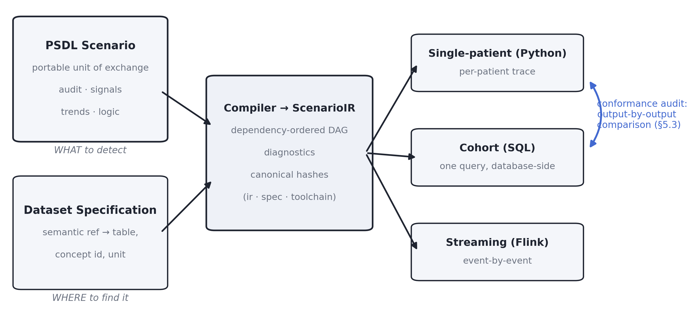
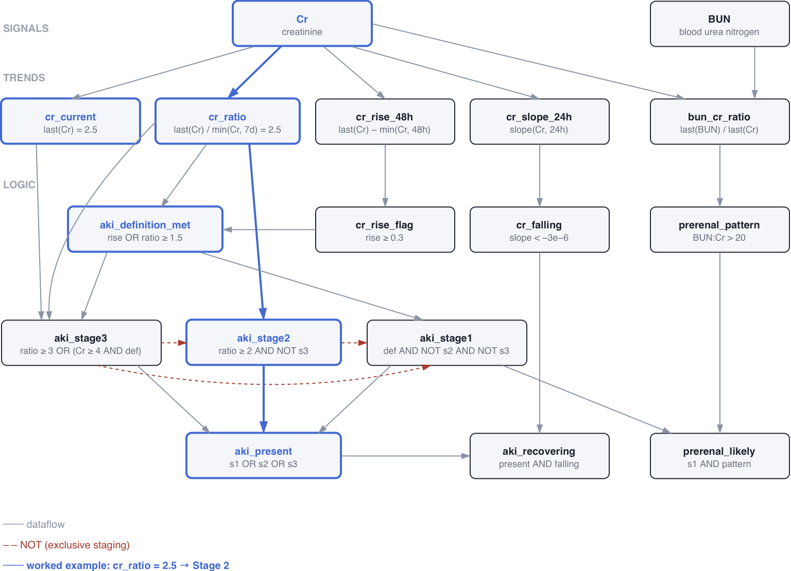
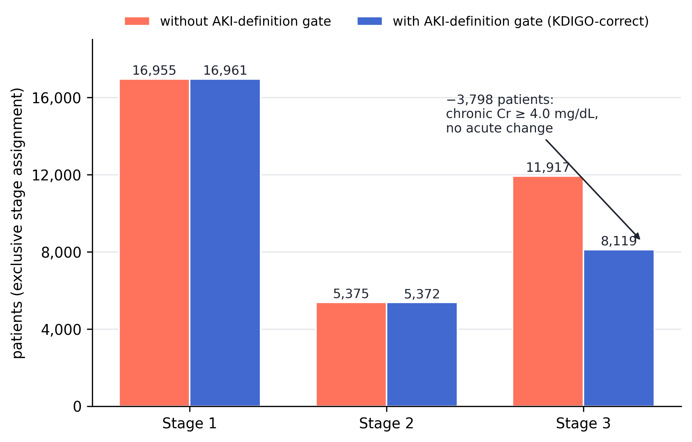
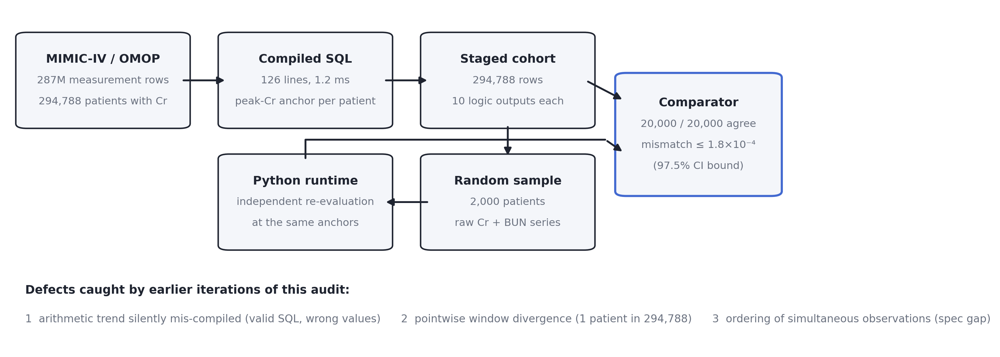

# PSDL: A Portable, Auditable Scenario Definition Language for Clinical Decision Logic

**Ziyuan Guan** — Independent Researcher (chesterfield199512@gmail.com)

*Submitted to Qeios, September 2026. Corresponds to psdl-lang v0.5.1.*

---

## Abstract

Clinical decision logic (the rules that define a cohort, screen for deterioration, or stage a disease) is re-implemented at every institution, in SQL scripts, vendor rule engines, and one-off analysis code. The logic itself has no portable, reviewable representation: what an IRB approves, what a data engineer executes, and what a paper reports are three different artifacts with no verifiable link between them. We present PSDL (Patient Scenario Definition Language), an open, vendor-neutral language for expressing clinical scenarios as declarative YAML documents composed of an audit block (intent, rationale, provenance), signal references, temporal trend computations, and boolean decision logic. A scenario is bound to physical data through a separate Dataset Specification, and compiles, through a specification-driven toolchain with canonical content hashing, to multiple execution targets: a per-patient Python evaluator, a SQL query for cohort-scale retrospective analysis, and a streaming pipeline. We demonstrate the language with a KDIGO acute kidney injury (AKI) staging scenario executed against a 287-million-row MIMIC-IV/OMOP database: 294,788 patients were staged in a single compiled SQL query (10.3% any-stage detection rate), and a consistency audit (independent per-patient Python re-evaluation of 2,000 randomly sampled patients, compared output by output against the SQL results) agreed on all 20,000 audited logic outputs. We also compared the staged cohort against ICD-coded AKI diagnoses; agreement was moderate, for reasons we examine. Earlier iterations of the same audit, run during development, did find defects, including a silently mis-compiled arithmetic expression and a window-semantics divergence that affected one patient in 294,788. We kept these defects in the paper because they show what conformance checking is for. We also introduce PSDL Inspector, an open-source authoring tool that turns a natural-language description into a validated, terminology-anchored, checksummed scenario bundle. PSDL is available under the Apache-2.0 license at https://github.com/Chesterguan/PSDL and on PyPI as `psdl-lang`.

**Keywords:** clinical decision support, phenotyping, domain-specific language, OMOP CDM, FHIR, reproducibility, KDIGO, MIMIC-IV

---

## 1. Introduction

Which of our patients developed acute kidney injury, and at what stage? The KDIGO criteria that answer this question fit in half a page [1]. Their executable form, however, is different in every institution: a SQL script against one warehouse schema, a rule in a vendor engine, a pandas notebook in a research group. None of these artifacts can be reviewed by the clinician who owns the question, compared across sites, or attached to a regulatory submission as the logic that actually ran.

This is a semantic-layer problem, and it has been solved before in other domains. SQL separated data questions from storage engines. ONNX separated trained models from inference runtimes [2]. In both cases the key step was the same: a portable representation with well-defined semantics, multiple independent implementations, and conformance testing connecting them.

PSDL (Patient Scenario Definition Language) applies that move to clinical decision logic. A PSDL *scenario* is a YAML document that declares:

- **why** the logic exists (a mandatory audit block: intent, rationale, provenance);
- **what data** it consumes (signals as semantic references such as `creatinine`, rather than a table and column);
- **what it computes** (trends: windowed temporal operators and arithmetic over them);
- **what it decides** (logic: a boolean DAG with explicit severities);
- **what it emits** (typed decision and feature outputs).

The scenario contains no institutional details. A separate *Dataset Specification* maps semantic references to physical bindings (tables, columns, terminology codes) for a particular data model, so the same scenario runs unchanged against any conforming source. A specification-driven compiler produces a hashed intermediate representation and executes it in three modes: single-patient (interactive Python), cohort (a generated SQL query executed database-side), and streaming (event-by-event evaluation).

The design aims at three properties:

1. **Portability.** The scenario document is the unit of exchange; institution-specific bindings live outside it.
2. **Auditability.** Provenance is a required field, not a comment, and canonical content hashes make "we ran exactly this logic" a checkable claim rather than an assertion.
3. **Determinism.** The same scenario over the same data must yield the same answers in every runtime. We treat this as a property to test, not to assume.



**Figure 1. PSDL architecture.** A scenario (the portable artifact) and a Dataset Specification (the site-specific bindings) compile into a hashed intermediate representation, which executes in three runtimes. The conformance audit of §5.3 compares two of them output by output.

This paper describes the language (§3) and its reference implementation (§4); works a complete example, KDIGO AKI staging over the MIMIC-IV database in OMOP format, through authoring, compilation, cohort-scale SQL execution, and a cross-runtime consistency audit (§5); introduces PSDL Inspector, a companion authoring tool (§6); and discusses limitations and future work, including multimodal data (§7). Throughout, we report the defects our own conformance checks caught during this work, because they illustrate the failure modes the design exists to prevent.

## 2. Related Work

**Clinical Quality Language (CQL).** HL7's CQL [3] is the closest relative: a declarative language for clinical logic, primarily developed for quality measures and decision support, with an ELM intermediate representation. PSDL differs in scope and emphasis. CQL is a general expression language over FHIR resources with a rich type system; PSDL is deliberately narrower (time-series signals, a fixed vocabulary of temporal operators, boolean logic) in exchange for direct compilability to set-based SQL over OMOP-shaped warehouses, streaming execution, and a canonical-hashing scheme aimed at audit trails. The two are complementary: PSDL scenarios target continuous-monitoring and retrospective-cohort patterns (trajectories, windows, staging) that are awkward to express and expensive to execute in resource-by-resource paradigms.

**OHDSI ATLAS cohort definitions.** The OHDSI ecosystem defines cohorts as JSON documents interpreted against the OMOP CDM by ATLAS/Circe [4]. These are portable within the OHDSI stack and have demonstrated the value of shareable executable phenotypes at scale. They are, however, bound to OMOP by construction, express primarily inclusion/exclusion set logic rather than temporal trajectory computations (slopes, deltas, in-language baselines), and do not carry an audit/provenance contract or a hash-based identity. PSDL borrows OHDSI's central insight, that the definition is the artifact, while abstracting the data model behind a binding layer.

**ONNX.** From ONNX [2] PSDL borrows its architectural stance: a specification (JSON Schema for documents, YAML operator definitions with per-dialect lowering rules, a canonical hashing spec) is the source of truth; the Python implementation is *a* reference, not *the* definition. Type definitions, operator metadata, SQL templates, and conformance tests in the reference implementation are code-generated from the specification files.

**Arden Syntax and its descendants** established the goal of shareable medical logic modules three decades ago [5]; their well-documented "curly braces problem", institution-specific data access embedded in the logic, is precisely the coupling PSDL's Dataset Specification layer is designed to eliminate.

## 3. Language Design

### 3.1 Anatomy of a scenario

A scenario is composed of named sections. The excerpt below is from the bundled KDIGO AKI scenario used in §5, abbreviated for space; the complete file is provided as Supplementary Scenario S1:

```yaml
psdl_version: "0.5"
scenario:
  name: AKI_KDIGO_Detection
  version: "2.1.0"
  description: "Detect and stage Acute Kidney Injury using KDIGO creatinine criteria"

audit:
  intent: "Detect and stage Acute Kidney Injury using KDIGO creatinine criteria"
  rationale: "Early AKI detection enables timely intervention"
  provenance:
    type: guideline
    reference: "KDIGO Clinical Practice Guideline for Acute Kidney Injury"
    version: "2012"

signals:
  Cr:  { ref: creatinine,          expected_unit: mg/dL }
  BUN: { ref: blood_urea_nitrogen, expected_unit: mg/dL }

trends:
  cr_current:  { expr: last(Cr) }
  cr_ratio:    { expr: last(Cr) / min(Cr, 7d) }     # baseline computed in-language
  cr_rise_48h: { expr: last(Cr) - min(Cr, 48h) }

logic:
  cr_rise_flag:       { when: cr_rise_48h >= 0.3 }
  aki_definition_met: { when: cr_rise_flag OR cr_ratio >= 1.5 }
  aki_stage3:
    when: cr_ratio >= 3.0 OR (cr_current >= 4.0 AND aki_definition_met)
    severity: critical
  aki_stage2: { when: cr_ratio >= 2.0 AND NOT aki_stage3, severity: high }
  aki_stage1: { when: aki_definition_met AND NOT aki_stage2 AND NOT aki_stage3,
                severity: medium }
```



**Figure 2. Evaluation DAG of the KDIGO AKI scenario.** Signals feed trends; trends feed a logic DAG in which the `aki_definition_met` gate and dashed NOT edges make staging mutually exclusive. Blue marks the path of the worked example (a patient with `cr_ratio` = 2.5, assigned Stage 2); the same per-node trace serves as the patient-level explanation discussed in §4.

Several design decisions are visible here:

**Trends are numeric; logic is boolean.** Trends apply temporal operators (`last`, `first`, `delta`, `slope`, `min`, `max`, `sma`, `ema`, `count`, `percentile`) over signals within time windows, and may combine operator calls arithmetically (`last(Cr) / min(Cr, 7d)`). All comparison and boolean composition happens in the logic layer. This separation keeps each layer independently checkable: the compiler warns about trends no logic consumes and signals no live trend touches.

**Operationalization choices are written in the language itself.** KDIGO staging is defined against a "baseline" creatinine that retrospective data rarely records. Here this is handled in the language: `min(Cr, 7d)` declares the operationalization (lowest value in the trailing seven days, a standard retrospective surrogate) where a reviewer can see and dispute it. Likewise, the KDIGO staging table applies only to patients who meet the AKI definition. The `aki_definition_met` node makes this gate explicit, so a chronically elevated creatinine of 4.5 mg/dL with no acute change is, correctly, not Stage 3. Mutually exclusive stage assignment ("highest stage wins") is expressed with `NOT` rather than left to a consumer's post-processing.

**The audit block is mandatory.** A scenario without intent, rationale, and provenance does not validate. The practical consequence is that the artifact a data engineer executes is the same artifact that carries the clinical justification an IRB or auditor reads. In a review workflow the block works like a cover sheet: a committee reads the stated intent and provenance in the same file whose hash identifies the logic under review, and any later change to that logic produces a new hash and therefore a new review object.

Scenarios may further declare a **population** section (inclusion/exclusion criteria), typed **outputs** (decision booleans and numeric features with declared units), and, since v0.5, **signal_groups**: bulk data-extraction declarations (a named renal panel, or "all laboratory results"), modeled on OHDSI concept sets, that feed downstream extraction pipelines without participating in logic.

### 3.2 Binding: the Dataset Specification

Signals refer to semantic names. A Dataset Specification, a separate and independently versioned YAML document validated against its own JSON Schema, maps each name to a physical binding for one data model:

```yaml
creatinine:
  table: measurement
  value_field: value_as_number
  time_field: measurement_datetime
  filter:
    concept_id: [3016723]   # semantic key; rendered per data model
  unit: mg/dL
```

Filter keys are themselves semantic (`concept_id` means "this table's concept column"); the resolver renders them to physical columns per data model (`measurement_concept_id` for OMOP measurements). The project ships a standard OMOP CDM v5.4 specification; institutions override only what differs locally (schema name, local code mappings). The same scenario, bound through a FHIR-oriented specification, runs against FHIR R4 endpoints.

### 3.3 Compilation, hashing, and the specification as source of truth

`compile_scenario()` resolves a scenario into a **ScenarioIR**: a dependency-ordered evaluation DAG with per-layer diagnostics (unknown references, cycles, unused elements) and three canonical hashes, covering the scenario content, the language specification version it was compiled under, and the toolchain. Two sites exchanging a scenario can verify, before comparing results, that they compiled byte-identical logic under the same semantics. For the scenario above, the current implementation reports `ir_hash aa0ff2744defd271…` under `spec_hash a8ab63b050c2cab5…`; these hashes appear in evaluation results, so a cohort table is traceable to the exact logic that produced it.

The specification files are the normative artifacts: JSON Schemas for scenarios and dataset specifications, YAML operator signatures with per-dialect SQL lowering templates, AST node definitions, a canonical-hashing specification, and a conformance test suite. The Python type definitions, operator metadata, SQL templates, and conformance tests are generated from them.

## 4. Reference Implementation

The reference implementation (`pip install psdl-lang`; Python ≥3.8; Apache-2.0) provides three runtimes over one compiled representation:

**Single-patient evaluation** fetches a patient's signal history through a pluggable `DataBackend` (in-memory, OMOP/SQL, FHIR R4, PhysioNet Challenge files) and evaluates trends and logic in Python. Missing data propagates as `None`, and every comparison over `None` is `False`; there is no imputation and no hidden default. Each evaluation result also serves as an explanation: it carries every computed trend value and the truth value of every logic node. "Why was this patient Stage 2?" has a mechanical answer (`cr_ratio = 2.5`, so `aki_stage2` fired and `aki_stage3` did not), read off the same DAG the compiler validated. Whether this per-node trace is *sufficient* explanation for bedside clinicians is an open usability question we have not studied (§7.1); what the design guarantees is that no decision is attributable to anything outside the declared logic.

**Cohort compilation** lowers the same scenario to a single SQL query: each temporal operator call becomes a common table expression from the specification's per-dialect template (for example, `slope` lowers to `REGR_SLOPE` over epoch seconds in PostgreSQL); arithmetic trends join their component CTEs per patient with `NULLIF`-guarded division; and the logic DAG is compiled from the parsed expression AST, with logic-to-logic references inlined, into `CASE` expressions over a `trend_values` relation, with `COALESCE(…, FALSE)` reproducing the Python runtime's null semantics exactly. The 200-line AKI scenario compiles in about a millisecond to 126 lines of SQL.

**Streaming evaluation** maintains windowed operator state per patient and re-evaluates logic event-by-event, targeting Apache Flink for deployment and a pure-Python engine for development.

At the time of writing the implementation comprises 588 passing tests, including generated conformance cases and the cross-runtime tests introduced in §5.5.

## 5. Worked Example: KDIGO AKI Staging on MIMIC-IV

### 5.1 Setting and protocol

We evaluated the AKI scenario of §3.1 against a local PostgreSQL 15 instance of the MIMIC-IV database [6] transformed to the OMOP Common Data Model (287 million `measurement` rows; laboratory results and vitals; standard OMOP vocabularies). The creatinine binding (LOINC-mapped OMOP concept 3016723) covers 4,849,711 non-null measurements from 294,788 patients (median 0.9 mg/dL, confirming mg/dL units). The evaluated cohort is defined as every patient with at least one non-null creatinine measurement. The scenario's declared population criteria (adults; excluding chronic dialysis and transplant patients) are **not** applied, because population compilation is not yet implemented in the cohort runtime (§7.1); counts here will differ from an eligibility-filtered cohort.

Because MIMIC-IV timestamps are shifted per patient into disjoint future ranges, a global evaluation time is meaningless. Each patient was therefore evaluated at the time of their **peak serum creatinine**, the anchor at which retrospective KDIGO staging is conventionally assessed. This was implemented by injecting a per-patient reference-time CTE into the compiled SQL (the compiler itself emits a single `:reference_time` parameter; per-patient anchoring is an experiment-layer rewrite, discussed as future work in §7). The full protocol, including the anchor's deterministic tie-breaking, ships as a runnable script (`scripts/experiment_aki_mimic.py`) with its JSON results committed alongside.

### 5.2 Cohort results

The compiled query staged all 294,788 patients in a single pass on commodity single-node hardware (no scenario-specific indexes, unbounded-history `last()` semantics); Table 1 summarizes the results.

**Table 1. KDIGO AKI staging of the MIMIC-IV/OMOP cohort (evaluated at each patient's peak-creatinine anchor).**

| Quantity | Value |
|---|---|
| Patients evaluated | 294,788 |
| KDIGO Stage 1 (exclusive) | 16,961 |
| KDIGO Stage 2 (exclusive) | 5,372 |
| KDIGO Stage 3 | 8,119 |
| Any AKI | 30,452 (10.3%) |
| Patients with BUN:Cr ratio > 20 among Stage 1* | 6,435 |
| Detection rate, male/female | 12.4% (16,981/137,392) / 8.6% (13,476/157,414) |
| SQL execution time (this run) | 485 s |
| Scenario→SQL compile time | 1.2 ms |

\*A BUN:creatinine ratio above 20:1 suggests prerenal physiology; the scenario reports it for Stage 1 patients as a triage hint, not a diagnosis.

A 10.3% any-stage detection rate across all patients with creatinine measurements (not only ICU admissions) is consistent with hospital-wide AKI incidence reported for KDIGO-based definitions [8]. The male-female difference (12.4% vs 8.6%) matches the direction reported in AKI epidemiology, but creatinine-based criteria are themselves sex-sensitive (baseline creatinine tracks muscle mass), so we present the split as a transparency measure rather than a finding. One intermediate result is worth reporting. Before the `aki_definition_met` gate was in place, Stage 3 counted 11,917 patients, roughly 3,800 of them chronic kidney disease patients whose creatinine sat above 4.0 mg/dL with no acute change. The corrected KDIGO reading (staging applies only when the AKI definition is met) removes them. Both figures are complete-population counts under two deterministic rule variants; the difference is a census difference attributable entirely to the changed line, with no sampling variation to test. A one-line change in a reviewable document moved the cohort by about 3,800 patients. Changes of this kind should be visible to a reviewer, not buried in a site-specific SQL script.



**Figure 3. Effect of the AKI-definition gate on stage assignment.** Complete-population counts under the two rule variants. Stages 1 and 2 are essentially unchanged; Stage 3 loses about 3,800 patients whose creatinine was chronically at or above 4.0 mg/dL with no acute change, which the KDIGO staging table does not classify as AKI.

### 5.3 Cross-runtime consistency

Determinism across runtimes is a claim to be tested. The compiled AKI scenario has 10 logic nodes (listed in Supplementary Scenario S1), so each audited patient contributes 10 boolean outputs. For 2,000 randomly sampled patients, we re-fetched raw creatinine and BUN series and re-evaluated the scenario independently in the per-patient Python runtime at the same anchors, then compared every logic output against the SQL row: all 20,000 boolean outputs agreed (0 mismatches). With zero observed events a two-sided interval degenerates, so we report the standard one-sided 97.5% Clopper-Pearson upper bound on the per-output mismatch rate: 1.8 x 10^-4. Agreement this complete is only meaningful if the audit can fail; §5.5 shows that it can and did.



**Figure 4. The cross-runtime consistency audit.** The compiled SQL stages the full cohort; an independent per-patient Python evaluation of a 2,000-patient random sample is compared output by output. Earlier iterations of the same audit caught the three defects listed, discussed in §5.5.

### 5.4 Agreement with ICD coding

As a first external reference, we compared PSDL's `aki_present` against AKI diagnosis codes (ICD-9-CM 584.x, ICD-10-CM N17.x) recorded anywhere in each patient's history. ICD coding is an imperfect reference: AKI is known to be under-coded, codes capture urine-output-based and clinically judged AKI that a creatinine-only scenario cannot see, and our single peak-creatinine anchor evaluates each patient at one time point. We therefore report agreement with coding practice, not diagnostic accuracy.

Of 42,553 ICD-coded AKI patients in the cohort, PSDL flagged 18,588 (sensitivity vs coding 43.7%); of 30,452 PSDL-flagged patients, 18,588 carried a code (PPV vs coding 61.0%); specificity vs coding was 95.3% and NPV 90.9%. Both discordance directions have structural explanations. PSDL misses coded cases when the creatinine was already elevated at the first available measurement (community-acquired AKI with no in-window rise), when AKI was staged on urine output, or when the peak-anchor window predates the coded episode. PSDL flags uncoded cases where creatinine dynamics met KDIGO criteria but no code was assigned; validation studies of AKI ICD codes report low sensitivity of coding against laboratory-defined AKI [9]. Disentangling these mechanisms requires chart review, which we have not done; the value of the comparison here is that every discordant patient carries a machine-readable explanation (their trend values and fired logic nodes), so the follow-up study is well-posed.

### 5.5 What the consistency audit caught

Executing the SQL path against a real database for the first time, and then comparing it against an independent runtime, surfaced three defects, in the following order:

1. **A silently mis-compiled expression.** An early cohort compiler parsed trend expressions with a prefix-anchored regular expression, so the compound expression `last(Cr) / min(Cr, 7d)` silently compiled to plain `last(Cr)`: valid SQL with wrong semantics. No syntax check or `EXPLAIN`-style pre-flight can catch a query that is well-formed and wrong. Cross-runtime value comparison caught it immediately.
2. **A window-semantics divergence that affected one patient in 294,788.** Pointwise operators (`last(X)`) are unbounded in the specification and in SQL, but the Python runtime fetched only the largest windowed trend's history (7 days) as an optimization. One sampled patient, whose last BUN preceded their creatinine peak by more than 7 days, therefore evaluated `prerenal_pattern` differently in the two runtimes. The fix (unbounded fetch when any pointwise call is present) now carries a regression test.
3. **An underdetermined ordering.** Repeated runs of the cohort query differ by roughly ±10 patients per stage (~0.05%): when a patient has two *different* values at the same timestamp, `last()` is underdetermined, and parallel scan order decides. This is a specification gap (canonical ordering of simultaneous observations) rather than an implementation bug, and we record it as future specification work instead of hiding it behind an arbitrary tie-break.

This problem is not specific to PSDL. Any system that translates clinical logic between representations, such as a visual cohort builder emitting SQL or a notebook rewritten as a production job, can fail in these ways, and most such systems have no mechanism that would surface the failures. A portable representation is what makes conformance testing possible at all.

### 5.6 Reproducibility

Reproducing the published numbers requires the scenario, the dataset specification, and the experiment script together: the per-patient anchoring rewrite of §5.1 is part of the protocol, so the script is a versioned artifact of this paper rather than an incidental helper. The scenario, dataset specification, experiment script, and result JSON are in the repository; MIMIC-IV is available to credentialed researchers via PhysioNet [6]. A zero-setup variant of the pipeline (bundled scenario, synthetic patients, live SQL compilation) runs in the browser via the `PSDL_Quickstart` Colab notebook.

## 6. Tooling: PSDL Inspector

A language usable only by people who write YAML by hand will not reach the clinicians who own the logic. **PSDL Inspector** (https://github.com/Chesterguan/psdl-inspector, MIT license) is an open-source, locally deployable authoring tool built on `psdl-lang`. From a one-sentence description such as *"Detect and stage acute kidney injury by the KDIGO criteria using serum creatinine"*, it:

1. **generates** a candidate scenario with a large language model, then **validates** it against the PSDL toolchain, retrying up to a bounded number of attempts until the document parses, compiles, and carries real thresholds; if attempts are exhausted the tool reports failure rather than emitting an unvalidated document. Generation does not remove the human: the audit block and the clinical appropriateness of thresholds still require expert review before certification;
2. renders the compiled logic as an **interactive DAG** with a semantic outline, so structural errors surface at authoring time rather than at review;
3. **anchors terminology** against the OMOP vocabulary (creatinine → LOINC 2160-0 / concept 3016723) with embedding-assisted search;
4. emits a **certified bundle** containing the scenario, its dataset bindings, canonical hashes, and an auto-drafted IRB-ready document; and
5. runs a **cost pre-flight**: a real `EXPLAIN` (metadata only; the query is never executed) against a configured warehouse, returning a GO / CAUTION / BLOCK verdict before anything touches patient rows.

Inspector's boundary is deliberate: it certifies scenarios and estimates cost, and it never executes them or reads patient data. The division of labor follows §5.5: an `EXPLAIN` pre-flight catches invalid SQL and runaway query plans, while only cross-runtime value comparison catches valid but wrong SQL. The two mechanisms complement each other.

## 7. Discussion

### 7.1 Limitations

*Language scope.* PSDL deliberately covers time-series signals, windowed temporal operators, arithmetic, and boolean logic. We ran into two expressiveness gaps in practice. First, **criterion counting**: scores like qSOFA [7] ("any 2 of 3") must be expanded into pairwise disjunctions, which is correct but clumsy, and a numeric score output currently cannot be expressed. A counting primitive is a candidate for v0.6. Second, **event ordering**: as §5.5 shows, simultaneous observations need a canonical order defined at specification level.

*The worked example.* The AKI scenario implements the creatinine arm of KDIGO only; urine-output criteria (which require weight-normalized rates) and RRT initiation (a procedure event) are documented exclusions. The population block (excluding chronic dialysis and transplant patients) is declared but not yet compiled into the cohort SQL, so the reported cohort includes patients a full implementation would exclude; the `aki_definition_met` gate mitigates, but does not eliminate, CKD-related misclassification. The peak-creatinine anchor evaluates each patient once, at maximal severity; this suits prevalence staging but not onset-time analyses. Support for per-patient reference times should move from the experiment script into the compiler.

*Evaluation breadth and bias.* We report one scenario, one database, one site, and consistency between two runtimes of one implementation. MIMIC-IV is a single-center, ICU-weighted population with per-patient date shifting; prevalence figures inherit those biases and are not population estimates. The stronger claims, cross-site portability of a scenario with only its dataset specification changed and cross-implementation conformance, are the natural next experiments; the specification's conformance suite exists to support the latter. Planned validation work, in order of priority: an external OMOP dataset (eICU) or a temporal split of MIMIC-IV; a side-by-side implementation of the same KDIGO scenario in CQL or ATLAS as an efficiency and expressiveness baseline; and a chart-review reference standard for the ICD comparison of §5.4.

*Validation depth.* Agreement between runtimes is not clinical validity. Comparing PSDL-staged AKI against chart-reviewed or ICD-coded ground truth at scale is future clinical-validation work; the bundled MIMIC demonstration notebook shows the design of such a comparison on the MIMIC-IV demo subset.

### 7.2 Future work: multimodal signals

PSDL's signal abstraction is a timestamped numeric stream. Much of medicine is not: waveforms, imaging, and clinical narrative drive real decisions. We do not think PSDL should become an image or text processing language. The natural extension instead treats **model outputs as signals**: a validated ECG classifier, an imaging-AI finding, or an NLP extractor emits timestamped, typed events (`af_burden`, `b_lines_present`, `smoking_status`) that a scenario consumes like any laboratory value, while the audit block records the producing model's identity, version, and validation provenance in the same way it records a guideline. This keeps the deterministic, auditable core intact while letting scenarios range over modalities; high-frequency waveforms additionally motivate sampled-signal operators in the streaming runtime. A forthcoming RFC will specify the provenance contract for model-derived signals; categorical/event signal types (present in the streaming layer, not yet first-class in batch semantics) are a prerequisite and are scheduled first.

### 7.3 Safety, ethics, and regulation

PSDL is infrastructure for expressing and executing logic, not a cleared clinical decision-support device, and nothing here should be read as a claim of clinical safety. The design nonetheless maps onto regulatory expectations in specific ways: the mandatory audit block gives IRBs and quality committees a reviewable statement of intent and provenance attached to the executable artifact itself; canonical hashes provide the change-control primitive (any modification to logic is a new, distinguishable artifact) that quality-management systems require; and deterministic, imputation-free semantics simplify the failure-mode analysis a deployment would need. PSDL addresses only the representability part of the regulatory picture: it makes the logic reviewable, identifiable, and reproducible. What it does not provide (clinical performance evidence, human-factors validation, monitoring of real-world drift) is exactly what a regulated deployment would still have to supply, and the MIMIC results in this paper (retrospective, single-site, ICD-referenced) do not substitute for it. De-identified data were used throughout under the PhysioNet data use agreement; no patient-level data are redistributed.

Nearer-term roadmap items follow directly from this paper's findings: compiling population criteria into cohort SQL, per-patient reference-time support in the compiler, canonical event ordering in the hashing specification, a criterion-counting primitive, and a second-language runtime (TypeScript) to make cross-implementation conformance testable.

## 8. Conclusion

Clinical decision logic today has no portable, reviewable, testable form. PSDL proposes one: scenarios as declarative documents with mandatory provenance, semantic data bindings, canonical hashes, and multiple execution targets connected by conformance testing. In our KDIGO case study the approach staged 294,788 real patients from a 287-million-row OMOP database with a single compiled query, agreed with an independent runtime on every audited output, and, during development, caught its own bugs through the same mechanism. What SQL became for data queries, an open scenario language can become for clinical logic. PSDL, its specification, and its tooling are offered as a concrete starting point.

---

## Data and Code Availability

- **Specification & reference implementation:** https://github.com/Chesterguan/PSDL (Apache-2.0); PyPI: `psdl-lang`.
- **PSDL Inspector:** https://github.com/Chesterguan/psdl-inspector (MIT).
- **Supplementary Scenario S1:** the complete KDIGO AKI scenario (`src/psdl/examples/aki_detection.yaml`, 200 lines including commentary), to be attached to the submission as supplementary material.
- **Experiment protocol & results:** `scripts/experiment_aki_mimic.py` and `scripts/experiment_aki_mimic_results.json` in the repository.
- **Interactive quickstart:** `examples/notebooks/PSDL_Quickstart.ipynb` (Colab-ready).

MIMIC-IV is available to credentialed researchers under the PhysioNet data use agreement; no patient-level data are redistributed with PSDL.

## Acknowledgments

**Generative AI disclosure (per Qeios policy).** Large language models were used, under the author's direction, to assist with drafting and revising the manuscript text, writing the figure-generation code, and implementing and testing parts of the reference implementation described here. All generated content was reviewed and verified by the author, who takes full responsibility for it. The PSDL Inspector tool (§6) itself uses an LLM for scenario generation, as described there. The article's cover image was generated with a text-to-image model (FLUX.1) and manually retouched; the four scientific figures were drawn programmatically (matplotlib) from the committed figure script.

## References

[1] Kidney Disease: Improving Global Outcomes (KDIGO) Acute Kidney Injury Work Group. KDIGO Clinical Practice Guideline for Acute Kidney Injury. *Kidney Int Suppl.* 2012;2(1):1–138.

[2] Bai J, Lu F, Zhang K, et al. ONNX: Open Neural Network Exchange. https://onnx.ai (accessed September 2026).

[3] Health Level Seven International. Clinical Quality Language (CQL), STU. https://cql.hl7.org (accessed September 2026).

[4] Hripcsak G, Duke JD, Shah NH, et al. Observational Health Data Sciences and Informatics (OHDSI): Opportunities for Observational Researchers. *Stud Health Technol Inform.* 2015;216:574–578.

[5] Hripcsak G. Writing Arden Syntax Medical Logic Modules. *Comput Biol Med.* 1994;24(5):331–363.

[6] Johnson AEW, Bulgarelli L, Shen L, et al. MIMIC-IV, a freely accessible electronic health record dataset. *Sci Data.* 2023;10:1.

[7] Singer M, Deutschman CS, Seymour CW, et al. The Third International Consensus Definitions for Sepsis and Septic Shock (Sepsis-3). *JAMA.* 2016;315(8):801–810.

[8] Zeng X, McMahon GM, Brunelli SM, Bates DW, Waikar SS. Incidence, outcomes, and comparisons across definitions of AKI in hospitalized individuals. *Clin J Am Soc Nephrol.* 2014;9(1):12–20.

[9] Waikar SS, Wald R, Chertow GM, et al. Validity of International Classification of Diseases, Ninth Revision, Clinical Modification codes for acute renal failure. *J Am Soc Nephrol.* 2006;17(6):1688–1694.
